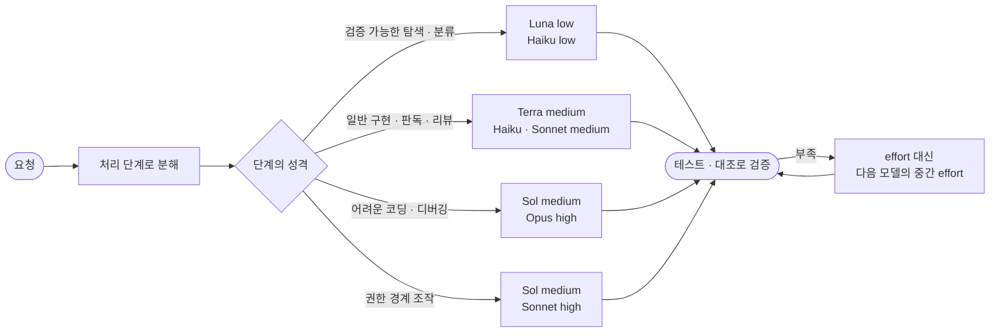

<div align="center">


# model-routing

**검증할 수 있는 단계는 싸게, 어려운 단계만 맞는 모델에게.**

작업을 처리 단계로 나누고, 단계마다 모델과 effort를 근거와 함께 고르고, 막혔을 때 어디로 넘길지 정하는<br>
Claude Code · Codex 공용 에이전트 스킬

[](.claude-plugin/plugin.json)
[](LICENSE)
[](#방법-2-claude-code-플러그인)
[](#방법-1-npx-skills-권장)
[](#근거로-쓴-측정)

[빠른 시작](#빠른-시작) · [사용법](#사용법) · [라우팅 흐름](#라우팅-흐름) · [모델 배치](#모델-배치) · [effort와 비용](#effort와-비용) · [규칙 원문 `SKILL.md`](SKILL.md)

</div>

---

## 빠른 시작

```bash
npx skills add sangwookp9591/model-routing -g -a claude-code codex -y
```

설치한 뒤 세션을 새로 열고 요청 앞에 붙인다.

```text
/model-routing
남은 작업을 정리하고, 작업별 모델·effort 배치표를 먼저 보여줘.
```

> [!TIP]
> Claude Code만 쓴다면 플러그인으로도 설치할 수 있다: `/plugin install model-routing --marketplace sangwookp9591/model-routing`

## 이 스킬이 하는 일

| | |
| --- | --- |
| 🧩 **단계 분해** | 요청을 처리 단계로 나누고, 단계마다 결과를 어떻게 확인할지 정한다 |
| 🎯 **모델 × effort 배치** | 단계마다 필요한 품질을 가장 싸게 내는 모델과 effort 조합을 고른다. Codex·Claude 환경별로 따로 |
| 📊 **근거 표시** | 배치마다 독립 측정·제조사 발표 출처와 근거 강도(높음·중간·낮음)를 붙인다 |
| 🪜 **승격과 복귀** | effort를 끝까지 올리지 않고 다음 모델의 중간 effort로 넘기며, 풀리면 1순위 모델로 돌아온다 |
| 💸 **비용 관리** | 토큰 단가가 아니라 작업당 비용(토큰·재시도·검증·인계)과 시간으로 판단한다 |
| 🚫 **제외 모델** | Fable·Gemini 계열은 배치·승격·대체·검증 어디에도 쓰지 않는다 |

## 라우팅 흐름



각 노드의 위 줄은 Codex(OpenAI), 아래 줄은 Claude 환경의 1순위다.

> [!IMPORTANT]
> 더 높은 품질이 필요하면 **effort를 끝까지 올리지 말고 다음 모델의 중간 effort로 바꾼다.** Artificial Analysis Intelligence Index v5.0(독립 측정)에서 Luna `max`(28점·작업당 $0.15)는 Terra `low`(29점·$0.07)보다 낮았고, Terra `max`(51점·$0.96·83초)는 Sol `high`(50점·$0.59·48초)와 비슷한 점수에 더 비싸고 느렸다.

## 설치

세 방법 중 하나만 고른다. 같은 스킬을 두 방법으로 설치하면 중복으로 로드된다. 어느 쪽이든 설치 후 Claude Code·Codex 세션을 새로 열어야 스킬이 인식된다.

| 방법 | 대상 | 업데이트 | 맞는 경우 |
| --- | --- | --- | --- |
| [1. `npx skills`](#방법-1-npx-skills-권장) | Claude Code + Codex | 명령 한 줄 | 두 에이전트를 함께 쓸 때 **(권장)** |
| [2. Claude Code 플러그인](#방법-2-claude-code-플러그인) | Claude Code | 자동 업데이트 가능 | Claude Code만 쓸 때 |
| [3. git clone + 링크](#방법-3-git-clone--링크) | Claude Code + Codex | `git pull` | 스킬을 직접 고치며 쓸 때 |

### 방법 1. `npx skills` (권장)

Node.js 18 이상이 필요하다. 한 번에 Claude Code와 Codex 양쪽에 설치되고, 이후 명령 한 줄로 업데이트할 수 있다.

```bash
npx skills add sangwookp9591/model-routing -g -a claude-code codex -y
```

| 옵션 | 의미 |
| --- | --- |
| `-g` | 사용자 전역에 설치. 빼면 현재 프로젝트(`.claude/skills`, `.agents/skills`)에만 설치 |
| `-a claude-code codex` | 설치 대상 에이전트. 하나만 쓰면 그 에이전트만 적는다 |
| `-y` | 확인 질문 생략 |

설치 결과는 다음과 같다.

- `~/.agents/skills/model-routing`: 실제 파일 (Codex가 읽는 경로)
- `~/.claude/skills/model-routing`: 위 폴더를 가리키는 링크 (Claude Code가 읽는 경로)

설치 확인: `npx skills list -g`

### 방법 2. Claude Code 플러그인

Claude Code 2.1.275 이상에서는 세션 안에서 한 줄로 설치한다.

```text
/plugin install model-routing --marketplace sangwookp9591/model-routing
```

<details>
<summary>이전 버전 · 터미널에서 설치하기</summary>

이전 버전이거나 마켓플레이스를 먼저 등록하고 싶으면 두 단계로 나눈다.

```text
/plugin marketplace add sangwookp9591/model-routing
/plugin install model-routing@model-routing
```

터미널에서는 같은 동작을 `claude plugin ...`으로 실행한다.

```bash
claude plugin marketplace add sangwookp9591/model-routing
claude plugin install model-routing@model-routing
```

</details>

설치 후 `/reload-plugins`를 실행하거나 세션을 새로 연다. 플러그인으로 설치한 스킬의 명시적 호출 이름은 `/model-routing:model-routing`이다.

자동 업데이트는 직접 추가한 마켓플레이스에서 기본으로 꺼져 있다. 켜려면 `/plugin` → **Marketplaces** 탭 → `model-routing` → **Enable auto-update**를 선택한다. 켜 두면 세션을 시작할 때 새 버전을 받아 오고, 다음 세션부터 적용된다.

### 방법 3. git clone + 링크

<details>
<summary>Node.js 없이 쓰거나, 스킬을 직접 고치면서 쓰고 싶을 때</summary>

```bash
git clone https://github.com/sangwookp9591/model-routing.git ~/skills/model-routing
mkdir -p ~/.claude/skills ~/.agents/skills
ln -s ~/skills/model-routing ~/.claude/skills/model-routing
ln -s ~/skills/model-routing ~/.agents/skills/model-routing
```

같은 경로에 이미 스킬이나 링크가 있으면 `ln -s`가 실패한다. 기존 항목을 확인한 뒤 필요한 것만 교체한다.

프로젝트 단위로만 쓰려면 링크 위치를 저장소 안으로 바꾼다.

| 환경 | 개인 스킬 경로 | 프로젝트 스킬 경로 | 명시적 호출 |
| --- | --- | --- | --- |
| Claude Code | `~/.claude/skills/model-routing` | `<repo>/.claude/skills/model-routing` | `/model-routing` |
| Codex | `~/.agents/skills/model-routing` | `<repo>/.agents/skills/model-routing` | `$model-routing` |

ChatGPT의 개인 스킬 생성·설치는 로컬 CLI의 폴더 연결과 별도다.

</details>

## 업데이트와 제거

| 설치 방법 | 새 버전 확인 | 업데이트 | 제거 |
| --- | --- | --- | --- |
| `npx skills` | `npx skills check` | `npx skills update model-routing` | `npx skills remove model-routing -g` |
| Claude Code 플러그인 | `/plugin` → **Installed** | `claude plugin update model-routing@model-routing` 또는 자동 업데이트 | `claude plugin uninstall model-routing@model-routing` |
| git clone | `git -C ~/skills/model-routing fetch && git -C ~/skills/model-routing status` | `git -C ~/skills/model-routing pull` | 두 링크와 clone 폴더 삭제 |

업데이트 후에는 진행 중인 세션을 새로 열어야 바뀐 규칙이 적용된다. 바뀐 내용은 저장소의 커밋 기록에서 확인한다.

## 사용법

### 호출 방식

| 방식 | Claude Code | Codex |
| --- | --- | --- |
| **자동 호출** | 모델 배치·effort 선택·작업 분배·승격 판단이 필요한 요청이면 에이전트가 스킬 설명을 보고 스스로 불러온다 | 같음 |
| **명시적 호출** | `/model-routing` (플러그인 설치 시 `/model-routing:model-routing`) | `$model-routing` |

> [!NOTE]
> 스킬은 모델을 **고르고 배치표를 만드는** 규칙이다. 실제로 다른 모델을 띄우려면 실행 환경에 서브에이전트·모델 선택 기능이 있어야 한다. 기능이 없으면 스킬은 배치안을 제안만 하고, 실제 실행 모델과 구분해 보고한다.

### 예시 1. 전체 리뷰 후 남은 작업 처리

```text
/model-routing
남은 작업을 먼저 정리하고, 코드 리뷰·리팩토링·기존 기능 검증을 마친 뒤 남은 작업을 처리해줘.
검증할 수 있는 단계는 싼 모델로, 어려운 부분만 적합한 모델에 배치해줘.
```

에이전트는 탐색 단계 모델(Luna low 또는 Haiku low)로 상태를 확인해 남은 작업을 먼저 공유하고, 영역별 리뷰 → 수정 → 회귀 검증 → 남은 작업 구현 → 결과 보고 순서로 진행한다.

### 예시 2. 실행 전에 배치표만 받기

```text
/model-routing
결제 모듈 리팩토링을 작업 단위로 나눠서, 작업별 모델·effort·근거·완료 기준 표만 먼저 보여줘. 실행은 아직 하지 마.
```

Codex 환경에서는 다음 형식의 표로 나온다.

| 작업 단계 | 모델 / effort | 선택 근거 (근거 강도) | 결과 확인 방법 |
| --- | --- | --- | --- |
| 결제 호출부 탐색·의존성 정리 | Luna 6 / low | 검증 가능한 탐색 (중간) | 호출부 목록과 의존 그래프 |
| DTO·Mapper 분리 | Terra 6.1 / medium | 범위가 정해진 일반 구현 (Terra 코딩은 낮음) | 타입 검사·단위 테스트 통과 |
| 재시도·멱등성 로직 재설계 | Sol 6.1 / medium | 동시성·불변 조건 보존이 걸린 어려운 코딩 (중간~높음) | 동시성 테스트 통과 |
| 리팩토링 결과 독립 리뷰 | Terra 6.1 / medium (별도 컨텍스트) | 코드 리뷰 1순위, 구현과 다른 컨텍스트 (낮음) | 리뷰 지적 사항 처리 |

Claude Code에서는 같은 단계가 Haiku 5.5 low → Haiku 5.5 medium → Opus 5.5 high → Sonnet 5.5 medium으로 배치된다.

<details>
<summary><b>예시 3~5 더 보기</b> · 실패한 작업 넘기기, 화면·문서 작업, 모델 제한</summary>

### 예시 3. 실패한 작업을 어디로 넘길지 판단

```text
/model-routing
Terra medium으로 이 race condition을 두 번 고쳤는데 테스트가 계속 간헐적으로 실패해. 다음에 어떻게 배치할지 판단해줘.
```

스킬은 바로 상위 모델로 올리지 않는다. 재현 조건·누락된 증거·환경 문제를 먼저 확인한다. 동시성 문제는 어려운 디버깅에 해당하므로 Terra의 effort를 올리지 않고 어려운 부분만 Sol 6.1 medium(Claude Code면 Opus 5.5 high)에 넘긴 뒤, 후속 작업은 1순위 모델로 돌려보낸다.

### 예시 4. 화면·문서 작업

```text
/model-routing
QA 스크린샷 40장에서 오류 화면을 분류하고 주간 보고서 초안을 써줘.
```

스크린샷 분류는 시각 판독 단계라 Terra medium(Claude Code면 단순 판독은 Haiku medium, 정밀 판독은 Opus high)에 두고, 사람에게 나가는 보고서 초안은 Sol medium 또는 Sonnet high로 나눈다. 시각 판독은 근거 강도가 '낮음'이라 처음 몇 장은 정답과 대조해 채점한 뒤 배치를 확정한다.

### 예시 5. 모델 제한을 걸어 쓰기

```text
/model-routing
이번 작업은 Claude 모델(Haiku 5.5, Sonnet 5.5, Opus 5.5)만 써. 예산은 Opus를 리뷰 한 번에만 쓰는 수준으로.
```

사용자가 지정한 모델 범위·예산을 스킬 기본값보다 우선한다. 요청한 모델을 쓸 수 없으면 다른 모델로 몰래 대체하지 않고 이유를 알린다.

</details>

## 핵심 원칙

- 배치 단위는 **모델 × effort**다. 토큰 단가가 아니라 작업당 비용과 시간으로 비교한다.
- 작업을 처리 단계로 나누고 단계마다 배치한다. 작업 전체를 한 모델에 맡기지 않는다.
- 결과를 테스트·스크립트·상위 모델이 다시 확인할 수 있는 단계는 **가장 싼 모델**(Luna 6 또는 Haiku 5.5, low~medium)에 둔다. 확인 없이 사람·커밋·배포로 나가는 단계는 한 단계 위 모델에 둔다.
- 더 높은 품질이 필요하면 effort를 끝까지 올리지 말고 **다음 모델의 중간 effort**로 바꾼다.
- 어려운 코딩·디버깅은 Sol 6.1 `medium`, Claude 환경에서는 Opus 5.5 `high`에서 시작한다.
- 회사를 넘는 비교는 **독립 측정**으로 한다. 근거 강도가 낮은 배치는 실제 과제 몇 건으로 채점해 확정한다.
- Terra에 배치할 때는 **권한·승인 설정을 끄지 않고**, 로그인·결제·삭제 같은 권한 경계 작업에는 쓰지 않는다.
- 계획·리뷰라는 이유만으로 Claude를, 브라우저·화면 조작이라는 이유만으로 Astra를 선택하지 않는다.
- Fable·Gemini는 승격, 대체 모델, 독립 검증에서도 제외한다.
- 모델 선택만으로 새로운 도구나 권한이 생기지는 않는다. 실행 환경의 실제 지원 여부를 확인한다.

## 모델 배치

아래는 공식 용도와 독립 측정을 바탕으로 한 운영상 배치이며, 고정 허용 목록이나 절대 성능 순위가 아니다.

| 모델 | 맡는 단계 | effort |
| --- | --- | --- |
| 🌙 **Luna 6** | 결과를 검증할 수 있는 기계적 단계: 탐색, 분류, 빌드·테스트 실행, 단일 파일 기계적 편집 | `low`~`medium` |
| 🌍 **Terra 6.1** | Codex 쪽 일반 작업의 기본: 일반 구현, 계획, 리뷰, 시각 판독, 원문 기반 요약·추출. 권한 경계 작업은 제외 | `medium`, `high`까지 |
| ☀️ **Sol 6.1** | 어려운 코딩·디버깅, 권한 경계 화면 조작, 사람에게 나가는 글의 초안 | `medium` → `high` |
| ✨ **Astra** | 저장소 단위 수정·마이그레이션, 장시간 연구, 여러 시스템 종합 | `high`, 저장소 단위는 `xhigh` |
| 🍃 **Haiku 5.5** | Claude 쪽 검증 가능한 단계와 하위 에이전트: 탐색, 분류, 범위가 정해진 구현, 주어진 문서에서 추출 | `low`~`medium` |
| 🎼 **Sonnet 5.5** | Claude 쪽 판단이 들어가는 단계: 계획, 코드 리뷰, 글 초안, 다단계 화면 조작 | `medium`~`high`, `xhigh`가 상한 |
| 🎻 **Opus 5.5** | Claude 쪽 어려운 코딩·디버깅, 정밀 시각 판독, 최종 보고서, 장시간 연구 | `high`, `max`는 쓰지 않음 |
| ➕ **그 밖의 사용 가능한 모델** | 공식 기능·비용·실제 가용성과 독립 측정을 확인하고 작업에 적합할 때 선택 | |

작업 유형별 1순위 요약이다. 승격 경로와 근거는 [`references/placement.md`](references/placement.md), 수치는 [`references/models.md`](references/models.md)에 있다.

| 작업 유형 | Codex (OpenAI) | Claude | 근거 강도 |
| --- | --- | --- | --- |
| 탐색·분류, 빌드·테스트 실행 | Luna `low` | Haiku `low` | 중간 |
| 계획·남은 작업 정리 | Terra `medium` | Sonnet `medium` | 낮음 |
| 일반 구현 | Terra `medium` | Haiku `medium` + 테스트 실행 | 중간 |
| 어려운 코딩·디버깅 | Sol `medium` → `high` | Opus `high` | 중간~높음 |
| 코드 리뷰 | Terra `medium` | Sonnet `medium` | 낮음 |
| 화면 조작: 읽기 위주 | Terra `medium` | Haiku `medium` | 낮음 |
| 화면 조작: 권한 경계 | Sol `medium` | Sonnet `high` | 낮음 |
| 시각 판독 | Terra `medium` | Opus `high` (단순 판독은 Haiku `medium`) | 낮음 |
| 보고서·글쓰기 | 초안 Sol `medium`, 최종본 Opus `high` | 초안 Sonnet `high`, 최종본 Opus `high` | 중간 |
| 사실 민감한 요약·추출 | Terra `medium` + 원문 인용 | Haiku `medium` (주어진 문서) | 중간 |
| 장시간 연구·여러 시스템 종합 | Astra `high` | Opus `high` | 중간 |
| 하위 에이전트 | Luna `low` ~ Terra `low` | Haiku `low`~`medium` | 중간 |

근거 강도는 **높음** = 독립 측정 두 곳 이상이 같은 방향, **중간** = 독립 측정 하나 또는 독립 소표본 실험, **낮음** = 제조사 발표만 있거나 직접 측정이 없음이다. '낮음' 배치는 실제 과제 3~5건으로 채점해 확정한다.

### 근거로 쓴 측정

- [Artificial Analysis Intelligence Index v5.0](https://artificialanalysis.ai/ko/models): 모델 × effort별 점수, 작업당 비용, 시간
- Terminal-Bench 4.0 ([Snorkel Harbor](https://snorkel.ai/leaderboard/terminal-bench/), [Artificial Analysis](https://artificialanalysis.ai/evaluations/terminalbench-4-0)), [DeepSWE](https://deepswe.datacurve.ai/): 코딩
- [Agents' Last Exam](https://snorkel.ai/leaderboard/agents-last-exam/), [arena Text](https://arena.ai/leaderboard/text)·[Vision](https://arena.ai/leaderboard/vision), Artificial Analysis 환각률: 장시간 작업, 글쓰기, 시각, 사실성
- 제조사 발표 수치는 따로 표시하고, 독립 측정과 다르면 독립 측정을 따른다. 화면 조작(OSWorld)은 아직 제조사 수치뿐이다.

## effort와 비용

- 시작점과 상한은 위 모델 표의 effort 열을 따른다. Sol 6.1과 Astra는 `none`을 지원하지 않는다.
- Terra가 `high`로 부족하면 `xhigh`·`max`로 올리지 말고 Sol `medium`·`high`로 바꾼다.
- Sonnet 5.5의 `high` 이상이 필요하면 Opus 5.5 `high`와 비교한다. Anthropic의 effort 곡선에서 Opus `high`(64.2%·$3.88)가 Sonnet `xhigh`(61.5%·$5.30)보다 점수는 높고 비용은 낮았다(제조사 발표).
- Haiku 5.5는 `low`에서 긴 에이전트 프롬프트를 받으면 확인을 생략하고 일찍 멈출 수 있다. 수정·추출은 `medium`에 두고 테스트 실행을 지시한다. 프롬프트가 100K 토큰을 넘는 요청은 전체가 5배 요율이다.
- 실제 실행 인터페이스에서 지원하는 effort만 사용한다. API의 지원 값과 앱·CLI 설정을 구분한다.
- 단가뿐 아니라 사용 토큰, 재시도, 검증, 인계 비용까지 고려한다. 상세 가격과 기준일은 [`references/models.md`](references/models.md), 출처는 [`references/sources.md`](references/sources.md)를 참조한다.

## orchestration과 함께 사용

`orchestration`은 작업 순서·의존성·상태를 관리하고, `model-routing`은 각 작업의 모델·effort를 선택한다. 이 스킬은 orchestration 자체를 설치하거나 모델 전환 기능을 구현하지 않는다.

전체 코드 리뷰 후 남은 작업을 처리할 때는 다음 순서를 따른다.

1. 현재 상태와 남은 작업을 확인해 먼저 공유한다.
2. 전체 코드를 영역별로 리뷰한다.
3. 필요한 수정과 리팩토링을 수행한다.
4. 기존 기능과 회귀 여부를 검증한다.
5. 남은 작업을 구현하고 검증한다.
6. 완료 사항, 미검증 항목, 차단 요인을 보고한다.

독립 검증은 별도 컨텍스트에서 구현과 다른 모델로 한다. 테스트·빌드 확인 같은 기계적 검증은 Luna `low` 또는 Haiku `low`로 충분하고, 판단이 필요한 리뷰는 코드 리뷰 배치를 따른다. 이미 승인·위임받은 범위는 반복 확인하지 않는다.

## 수정과 기여

- 규칙의 기준은 `SKILL.md`와 `references/`다. README는 요약과 사용법이므로 규칙을 바꾸면 함께 고친다.
- 모델·가격·벤치마크 수치를 추가할 때는 `references/sources.md`에 출처와 확인일을 남기고, 본문 수치에 `[독립]`·`[제조사]`·`[2차]`를 붙인다. Artificial Analysis 지수는 버전이 다른 점수끼리 비교하지 않는다.
- 변경은 이슈나 PR로 제안한다. `main`에 반영되면 사용자는 [업데이트](#업데이트와-제거) 명령으로 받는다.
- 배포할 변경은 `.claude-plugin/plugin.json`의 `version`(semver)을 올린 뒤 push한다. 버전을 그대로 두면 Claude Code 플러그인 사용자는 이전 사본을 계속 쓴다. 규칙 문구 수정은 patch, 배치 규칙 추가·변경은 minor, 호환되지 않는 구조 변경은 major를 올린다.
- 매니페스트를 고친 뒤에는 저장소 루트에서 `claude plugin validate . --strict --profile directory`를 실행한다.

<details>
<summary><b>저장소 구조</b></summary>

```text
model-routing/
├── SKILL.md                     # 라우팅 절차와 원칙 (스킬 본체)
├── references/
│   ├── placement.md             # 작업 유형별 배치표·예시
│   ├── models.md                # 모델별 근거 수치·단가
│   └── sources.md               # 출처와 확인일
├── README.md                    # 설치·사용법·요약
├── PRIVACY.md                   # 개인정보 처리방침
├── LICENSE                      # MIT
└── .claude-plugin/
    ├── plugin.json              # Claude Code 플러그인 매니페스트
    ├── marketplace.json         # 단일 플러그인 마켓플레이스
    └── icon.png                 # 디렉터리 목록 아이콘
```

</details>

## 공식 문서

<details>
<summary>확인일: 2026-10-28. 기능·가격·설치 경로가 바뀌면 최신 공식 문서로 확인한다.</summary>

- [OpenAI 모델 가이드](https://developers.openai.com/api/docs/guides/latest-model)
- [Luna 6](https://developers.openai.com/api/docs/models/gpt-6-luna) · [Terra 6.1](https://developers.openai.com/api/docs/models/gpt-6.1-terra) · [Sol 6.1](https://developers.openai.com/api/docs/models/gpt-6.1-sol) · [Astra](https://developers.openai.com/api/docs/models/gpt-6-astra)
- [Terra 6.1 시스템 카드 부록](https://deploymentsafety.openai.com/gpt-6-1-terra/addendum-to-gpt-6-astra-system-card-gpt-6.1-terra)
- [Haiku 5.5](https://platform.claude.com/docs/en/models/haiku-5-5/whats-new-haiku-5-5) · [Sonnet 5.5](https://www.anthropic.com/claude-sonnet-5-5) · [Opus 5.5](https://platform.claude.com/docs/en/models/opus-5-5/overview)
- [Claude effort](https://platform.claude.com/docs/en/build-with-claude/effort) · [Claude 가격](https://platform.claude.com/docs/en/about-claude/pricing)
- [Claude Code 스킬 설치](https://code.claude.com/docs/en/skills)
- [Claude Code 플러그인 설치·업데이트](https://code.claude.com/docs/en/plugins/install)
- [Codex 스킬 설치](https://learn.chatgpt.com/docs/build-skills)
- [skills CLI (`npx skills`)](https://github.com/vercel-labs/skills)

</details>

---

<div align="center">

[MIT](LICENSE) · [개인정보 처리방침](PRIVACY.md) · [이슈 남기기](https://github.com/sangwookp9591/model-routing/issues)

</div>
