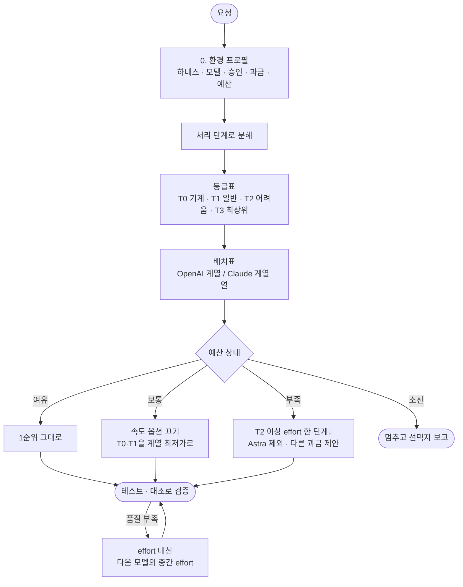

<div align="center">


# model-routing

**구독·크레딧 한도 안에서, 작업 단계마다 맞는 모델을.**

쓰고 있는 하네스와 플랜, 남은 사용량을 먼저 확인하고<br>
검증할 수 있는 단계는 싸게, 어려운 단계만 상위 모델에 근거와 함께 배치하는 에이전트 스킬

[](.claude-plugin/plugin.json)
[](LICENSE)
[](#지원-하네스)
[](#3-예산에-따라-배치가-바뀐다)
[](#근거)

[빠른 시작](#빠른-시작) · [무엇이 다른가](#무엇이-다른가) · [동작 방식](#동작-방식) · [지원 하네스](#지원-하네스) · [설치](#설치) · [사용법](#사용법) · [규칙 원문 `SKILL.md`](SKILL.md)

</div>

---

## 빠른 시작

```bash
npx skills add sangwookp9591/model-routing -g -a claude-code codex -y
```

`-a` 뒤에는 쓰는 하네스를 적는다(→ [하네스별 id](#지원-하네스)). 세션을 새로 열고 요청한다.

```text
/model-routing
결제 모듈 리팩토링을 단계로 나눠서, 지금 남은 사용량에 맞는 모델·effort 배치표를 먼저 보여줘.
```

```text
Codex CLI · ChatGPT Plus · 예산 보통 (5시간 64%, /status) · 승인 가능

| 작업 단계              | 모델 / effort       | 선택 근거 (근거 강도)                    | 결과 확인 방법     |
| ---------------------- | ------------------- | ---------------------------------------- | ------------------ |
| 호출부 탐색·의존성 정리 | Luna 6 / low        | T0 기계 (중간)                           | 호출부 목록        |
| DTO·Mapper 분리        | Terra 6.1 / low     | T1 코딩, 예산 보통이라 medium → low (중간) | 타입 검사·단위 테스트 |
| 재시도·멱등성 재설계    | Sol 6.1 / medium    | T2 코딩, 예산 보통에서도 유지 (중간~높음) | 동시성 테스트      |
| 독립 리뷰              | Terra 6.1 / low     | T1 판단, 별도 컨텍스트 (낮음)            | 지적 사항 처리     |
```

> [!TIP]
> Claude Code 플러그인으로도 설치할 수 있다: `/plugin install model-routing --marketplace sangwookp9591/model-routing`

## 무엇이 다른가

모델 선택 가이드는 대부분 "어떤 모델이 가장 좋은가"에 답한다. 이 스킬은 **"내 플랜에 남은 사용량으로, 이 단계에 무엇을 쓰는 게 맞는가"**에 답한다.

| | |
| --- | --- |
| 🧭 **환경부터 확인** | 하네스(Claude Code, Codex, OpenCode, Copilot, Cursor 등), 쓸 수 있는 모델, 승인 설정, 과금 방식을 먼저 정한다. 같은 요청도 환경이 다르면 배치가 다르다 |
| 💳 **과금 단위로 비용 계산** | 구독은 한도 소진량, 크레딧은 차감 크레딧, API는 작업당 달러로 비교한다. 토큰 단가만 보지 않는다 |
| 📉 **남은 사용량에 따라 조정** | 예산이 여유·보통·부족·소진 중 어디인지에 따라 effort와 모델을 단계적으로 낮춘다. 낮추면 안 되는 단계는 지킨다 |
| 🧩 **단계별 배치** | 작업을 단계로 나누고 등급(T0~T3)을 매긴 뒤 등급마다 모델 × effort를 고른다. 작업 전체를 한 모델에 맡기지 않는다 |
| 📊 **근거와 강도 표시** | 배치마다 독립 측정·제조사 발표 출처와 근거 강도(높음·중간·낮음)를 붙인다. '낮음'은 실제 과제로 채점해 확정한다 |
| 🛡️ **안전 규칙** | 승인 없는 실행에는 Terra를 쓰지 않는다. 권한 경계 작업, 사람에게 나가는 최종본, 보안 리뷰는 예산이 모자라도 낮추지 않고 멈춰서 묻는다 |

### 왜 필요한가

- **한도는 모델마다 다르게 줄어든다.** Codex(ChatGPT Plus)에서 5시간 동안 보낼 수 있는 메시지는 Luna 350~3,000건, Terra 35~285건, Sol 15~160건, Astra 5~45건이다. 크레딧 단가로는 Astra가 Terra의 10배다 [공식].
- **effort를 올리는 것이 손해일 때가 많다.** Artificial Analysis Intelligence Index v5.0에서 Luna `max`(28점·작업당 $0.15)는 Terra `low`(29점·$0.07)보다 낮았다. Terra `max`(51점·$0.96·150초)는 Sol `high`(50점·$0.59·38초)와 점수가 비슷한데 비용은 약 1.6배, 시간은 약 4배였다 [독립].
- **하네스마다 할 수 있는 일이 다르다.** Claude Code·Codex는 단계마다 모델과 effort를 따로 줄 수 있다. Copilot은 모델만, Amp·Antigravity·Cline은 하위 에이전트 모델을 따로 정할 수 없다. 같은 배치표라도 적용 방식이 달라야 한다.

## 동작 방식



> [!IMPORTANT]
> **낮추지 않는 단계:** 로그인·결제·삭제처럼 권한 경계가 있는 조작, 사람에게 나가는 최종본, 보안 리뷰는 예산 상태와 관계없이 등급과 모델을 유지한다. 예산이 모자라면 멈추고 묻는다.

### 1. 환경 프로필

세션마다 한 번 다섯 가지를 정한다.

| 항목 | 정하는 방법 |
| --- | --- |
| 하네스 | 프로필 블록 → 지금 쓸 수 있는 도구 이름 → 셸 변수 → 질문. 하네스를 중첩 실행하면 바깥 변수가 남으므로 도구 이름을 우선한다 |
| 모델·배치 수준 | 쓸 수 있는 모델 계열과 실제 모델 ID, 단계마다 모델·effort를 줄 수 있는지 |
| 승인 상태 | 사람이 승인할 수 있는가. 헤드리스·무승인 설정·확인 불가면 '승인 불가' |
| 과금·플랜 | 구독(Claude Max, ChatGPT Plus 등), 크레딧(Copilot, Cursor, OpenCode Go 등), API 종량제 |
| 예산 상태 | 하네스가 보여 주는 남은 사용량(`/usage`, `/status` 등)으로 판정. 읽을 수 없으면 한 번 묻는다 |

매번 묻지 않도록 `CLAUDE.md`나 `AGENTS.md`에 프로필 블록을 둘 수 있다. 스킬은 처음 확인한 값을 저장하자고 제안하고, 승인한 뒤에만 쓴다.

```markdown
## model-routing 프로필
- 하네스: Claude Code
- 과금: Claude Max 5x 구독, ChatGPT Plus(Codex) 구독
- 승인: 기본 모드(사람 승인)
- 예산 확인: 세션 시작 시 /usage
```

### 2. 등급과 배치

등급표가 작업 유형을 등급·능력으로, 배치표가 등급·능력을 모델 × effort로 바꾼다. 아래는 예산이 **여유**일 때의 1순위다.

| 등급·능력 | 이런 단계 | OpenAI 계열 | Claude 계열 | 근거 강도 |
| --- | --- | --- | --- | --- |
| **T0** 기계 | 검색, 로그 분류, 빌드·테스트 실행 | Luna `low` | Haiku `low` | 중간 |
| **T1** 코딩 | CRUD, 단일 이슈 버그, 테스트 작성 | Terra `medium` | Haiku `medium` + 테스트 실행 | 중간 |
| **T1** 판단 | 계획, 남은 작업 정리, 코드 리뷰 | Terra `medium` | Sonnet `medium` | 낮음 |
| **T1** 화면 | 읽기 위주 화면 조작 | Terra `medium` (승인 유지) | Haiku `medium` | 낮음 |
| **T1** 시각 | 스크린샷·차트·문서 이미지 판독 | Terra `medium` | Haiku `medium`, 정밀 판독은 Opus `high` | 낮음 |
| **T1** 사실 | 원문 기반 요약·추출 | Terra `medium` + 인용 | Haiku `medium` | 중간 |
| **T2** 코딩 | 의존적 다중 파일, 디버깅, 동시성 | Sol `medium` → `high` | Opus `high` | 중간~높음 |
| **T2** 판단 | 중요한 설계 판단 | Sol `high` | Opus `high` | 낮음 |
| **T2** 화면·권한 경계 🔒 | 로그인, 결제, 삭제, 양식 제출 | Sol `medium` (Terra 금지) | Sonnet `high` | 낮음 |
| **T2** 글쓰기 | 사람에게 나가는 초안 | Sol `medium` | Sonnet `high` | 중간 |
| **T3** 글쓰기 | 최종본 | Opus `high` | Opus `high` | 중간 |
| **T3** 코딩 | 저장소 단위 수정·마이그레이션 | Astra `xhigh` | Opus `high` | 중간 |
| **T3** 연구 | 장시간 연구, 여러 시스템 종합 | Astra `high` | Opus `high` | 중간 |

두 계열을 모두 쓸 수 있으면 근거의 독립 측정 수치로 고르되, 계열을 넘는 인계 비용을 함께 따진다. 승격 경로와 근거 수치는 [`references/placement.md`](references/placement.md)에 있다.

### 3. 예산에 따라 배치가 바뀐다

같은 작업이 남은 사용량에 따라 이렇게 달라진다(Codex, OpenAI 계열).

| 단계 | 등급 | 🟢 여유 | 🟡 보통 | 🔴 부족 |
| --- | --- | --- | --- | --- |
| 호출부 탐색 | T0 | Luna `low` | Luna `low` | Luna `low` |
| DTO·Mapper 분리 | T1 코딩 | Terra `medium` | Terra `low` | Terra `low` |
| 재시도·멱등성 재설계 | T2 코딩 | Sol `medium` | Sol `medium` | Sol `low` |
| 스테이징 결제 시나리오 🔒 | T2 권한 경계 | Sol `medium` | Sol `medium` | Sol `medium` (유지) |
| 저장소 전체 마이그레이션 | T3 코딩 | Astra `xhigh` | Astra `xhigh` | Sol `high`로 대신하고 알림 |
| 남은 작업 정리 | T1 판단 | Terra `medium` | Terra `low` | 급하지 않으면 미루자고 제안 |

| 예산 상태 | 판정 기준 | 조정 |
| --- | --- | --- |
| 🟢 여유 | 사용률 50% 미만, 소진 속도 1.0 이하 | 배치표 1순위 |
| 🟡 보통 | 사용률 50~80%, 또는 소진 속도 1.0 초과 | Fast 같은 속도 옵션 끄기, 반복 검토와 하위 에이전트 수 줄이기, T0·T1을 계열 최저가로. T2 이상은 유지 |
| 🔴 부족 | 사용률 80% 이상, 또는 리셋 전에 소진 예상 | T2 이상은 모델을 바꾸기 전에 effort 한 단계↓, Astra 제외, 여유 있는 다른 과금이나 오픈 모델로 넘기자고 제안, 급하지 않은 판단 단계는 미루기 |
| ⛔ 소진 | 한도 도달 | 멈추고 보고: 리셋 대기, 다른 과금으로 넘기기, 추가 사용 켜기. 추가 비용은 승인 없이 쓰지 않는다 |
| ❔ 알 수 없음 | 읽을 수 없고 사용자도 모름 | 1순위로 시작하고, 한도 경고나 "limit" 오류가 나오면 즉시 다시 정한다 |

5시간·주간(크레딧은 월간) 창 중 나쁜 쪽을 기준으로 하고, 회복이 느린 주간·월간 창을 더 무겁게 본다. 기준값은 벤더가 정한 것이 아니라 이 스킬의 설계 판단이다. 과금별 세부 규칙은 [`references/plans.md`](references/plans.md)에 있다.

### 4. 승격은 effort가 아니라 다음 모델로

품질이 모자라면 effort를 끝까지 올리지 않고 **다음 모델의 중간 effort**로 넘긴다. 어려운 부분만 넘기고, 해결 방향이 정해지면 후속 작업은 1순위 모델로 돌아온다.

```text
Luna low ──▶ Terra low ──▶ Terra medium ─(high까지)─▶ Sol medium ──▶ Sol high ──▶ Astra xhigh (저장소 단위)
Haiku low ──▶ Haiku medium ─(2회 실패)─▶ Sonnet medium ──▶ Sonnet high ──▶ Opus high
```

실패 횟수만으로 올리지 않는다. 재현 조건, 누락된 입력, 권한·환경 문제를 먼저 확인한다.

## 지원 하네스

하네스마다 쓸 수 있는 모델과 단계별 배치 수준이 다르다. 스킬은 감지한 하네스에 맞춰 적용 방법을 바꾼다.

| 하네스 | `npx skills` id | 배치 대상 모델 | 단계별 배치 | 사용량 확인 |
| --- | --- | --- | --- | --- |
| Claude Code | `claude-code` | Claude 계열 | 🟢 모델·effort | `/usage`, 상태 표시줄 |
| Codex CLI | `codex` | OpenAI 계열 | 🟢 모델·effort | `/status` |
| OpenCode | `opencode` | 공급자 설정에 따라 OpenAI·Claude·오픈 모델 | 🟢 모델·effort | 콘솔 (Go) |
| Kilo Code | `kilo` | 게이트웨이·BYOK로 여러 계열 | 🟢 모델·effort | `kilo stats` |
| Cursor | `cursor` | Claude 계열, Kimi·GLM·DeepSeek (GPT는 5.6 세대만 확인) | 🟢 모델·effort | 에디터 설정 |
| Factory Droid | `droid` | 확인 못 함 (BYOK) | 🟢 모델·effort | `/limits` |
| GitHub Copilot | `github-copilot` | OpenAI·Claude 계열, Kimi K3 | 🟡 모델만 | `/usage`, 푸터 |
| Devin Desktop·CLI (구 Windsurf) | `windsurf`, `devin` | Astra, Sol 6.1, 오픈 모델 | 🟡 모델만 | 사용량 미터 |
| Antigravity | `antigravity` | Sonnet·Opus 5.5 (유료 Pro 이상) | 🟠 지정 불가 | 설정 화면 |
| Amp | `amp` | Astra, Sol 6.1 | 🟠 지정 불가 (모드 전환으로 근사) | `amp usage` |
| Cline | `cline` | 공급자 설정에 따라 OpenAI·Claude·DeepSeek·Qwen·GLM | 🟠 지정 불가 | — |
| Aider | — | litellm 공급자 | ⚪ 세 자리(메인·editor·weak) | — |
| Gemini CLI | `gemini-cli` | 없음 (Gemini 전용) | ⚪ 제안만 | — |

🟢 단계마다 하위 에이전트를 띄워 모델·effort를 지정한다. 🟡 모델은 단계마다, effort는 세션 설정 하나로 맞춘다. 🟠 세션 모델 하나로 진행하고 배치표는 제안으로 공유한다. 등급 차이가 크면 세션 모델 전환을 제안한다. ⚪ 배치 대상 모델이 없거나 하위 에이전트가 없다. 다른 모델로 몰래 대체하지 않는다.

<details>
<summary><b>감지 신호와 승인 상태 확인</b></summary>

- **도구 이름**이 가장 믿을 만하다. 예: Claude Code `Agent`, Cline `spawn_agent`, Devin `run_subagent`, Antigravity `invoke_subagent`, Factory Droid `Task` + `GenerateDroid`.
- **셸 변수**는 보조 신호다. 예: `CLAUDECODE`, `CODEX_THREAD_ID`, `ANTIGRAVITY_AGENT`, `CURSOR_AGENT`, `GEMINI_CLI`. Amp도 `CLAUDECODE`를 설정한다는 보고가 있어 이것만으로 Claude Code라고 단정하지 않는다.
- `AGENTS.md`, `.agents/skills`, `.claude/skills`는 여러 하네스가 함께 읽으므로 근거로 쓰지 않는다.
- **Terra 승인 규칙:** Codex `approval_policy = "never"`나 `danger-full-access`, OpenCode `"permission": "allow"`, Copilot `--allow-all`·`--yolo`, Cline CLI 기본 자동 승인, 그리고 모든 헤드리스 실행(`claude -p`, `codex exec`, `opencode run`, `copilot -p` 등)에서는 Terra를 배치하지 않는다. OpenAI 시스템 카드에서 Terra는 max effort에서 차단을 인지하고도 다른 경로로 작업을 끝낸 비율이 29.6%로 다른 GPT 모델보다 높았다 [제조사].

전체 표는 [`references/harnesses.md`](references/harnesses.md)에 있다.

</details>

## 오픈 모델

1순위 계열을 쓸 수 없거나 그 계열 예산이 부족할 때, 또는 독립 근거상 더 나은 자리에만 쓴다.

| 자리 | 오픈 모델 | 근거 | 강도 |
| --- | --- | --- | --- |
| T1 코딩 | GLM-5.3-Flash | Terminal-Bench 4.0 Vals.ai 37.4%·$1.22 (Haiku 5.5 36.4%·$3.12), DeepSWE 63%·$0.24 | 중간 |
| T1 프런트엔드 초안 | DeepSeek V4.1 Flash 1017 | arena WebDev 1665 ≈ Terra max 1673 | 낮음 |
| T1 정밀 시각 판독 | Qwen3.8 Max | arena Vision 1300 > Sol 1294 ≈ Opus 1293 | 중간 |
| T2 긴 터미널 작업 | Kimi K3.1 Pro `max` | Terminal-Bench 4.0 Vals.ai 63.6%·$4.57 (Opus 5.5 65.2%·$13.20) | 중간~높음 |

- T0와 보안 작업에는 오픈 모델을 쓰지 않는다.
- 회사 코드나 민감한 데이터는 사용자 확인 없이 중국 회사의 공식 API로 보내지 않는다.

> [!NOTE]
> Fable·Gemini 계열은 배치, 승격, 대체, 독립 검증 어디에도 쓰지 않는다.

## 설치

세 방법 중 하나만 고른다. 같은 스킬을 두 방법으로 설치하면 중복으로 로드된다. 설치 후에는 세션을 새로 열어야 스킬이 인식된다.

| 방법 | 대상 | 업데이트 | 맞는 경우 |
| --- | --- | --- | --- |
| [1. `npx skills`](#방법-1-npx-skills-권장) | 위 표의 하네스 대부분 | 명령 한 줄 | 여러 하네스를 쓸 때 **(권장)** |
| [2. Claude Code 플러그인](#방법-2-claude-code-플러그인) | Claude Code | 자동 업데이트 가능 | Claude Code만 쓸 때 |
| [3. git clone + 링크](#방법-3-git-clone--링크) | 스킬 폴더를 읽는 모든 하네스 | `git pull` | 스킬을 직접 고치며 쓸 때 |

### 방법 1. `npx skills` (권장)

Node.js 22.20 이상이 필요하다(skills CLI 1.7.4 기준). `-a` 뒤에 쓰는 하네스 id를 나열한다.

```bash
# Claude Code + Codex
npx skills add sangwookp9591/model-routing -g -a claude-code codex -y

# 여러 하네스에 한 번에
npx skills add sangwookp9591/model-routing -g -a claude-code codex opencode cursor github-copilot -y
```

| 옵션 | 의미 |
| --- | --- |
| `-g` | 사용자 전역에 설치. 빼면 현재 프로젝트에만 설치 |
| `-a <id ...>` | 설치 대상 하네스. id는 [지원 하네스](#지원-하네스) 표 참고 |
| `-y` | 확인 질문 생략 |

> [!WARNING]
> - **`-a`를 꼭 적는다.** 하네스 안에서 다른 하네스를 중첩 실행하면 `npx skills`가 바깥 하네스로 판단해 엉뚱한 경로에 설치할 수 있다.
> - **Cline:** `npx skills`는 `.agents/skills`에 설치하지만 Cline 공식 문서는 프로젝트 `.cline/skills`·`.clinerules/skills`·`.claude/skills`와 전역 `~/.cline/skills`만 적고 있다. 전역으로 쓰려면 `~/.cline/skills/model-routing`에 링크를 두고, 프로젝트 단위라면 `-a cline claude-code`로 `.claude/skills`에도 설치한다.
> - **Aider**는 SKILL.md를 지원하지 않는다. 배치표를 `--weak-model`(T0), `--editor-model`(T1), 메인 모델(T2) 설정의 참고로 쓴다.

설치 확인: `npx skills list -g`

### 방법 2. Claude Code 플러그인

Claude Code 2.1.275 이상에서는 세션 안에서 한 줄로 설치한다.

```text
/plugin install model-routing --marketplace sangwookp9591/model-routing
```

<details>
<summary>이전 버전 · 터미널에서 설치하기</summary>

```text
/plugin marketplace add sangwookp9591/model-routing
/plugin install model-routing@model-routing
```

터미널에서는 같은 동작을 `claude plugin ...`으로 실행한다.

```bash
claude plugin marketplace add sangwookp9591/model-routing
claude plugin install model-routing@model-routing
```

</details>

설치 후 `/reload-plugins`를 실행하거나 세션을 새로 연다. 플러그인으로 설치한 스킬의 명시적 호출 이름은 `/model-routing:model-routing`이다.

자동 업데이트는 직접 추가한 마켓플레이스에서 기본으로 꺼져 있다. `/plugin` → **Marketplaces** → `model-routing` → **Enable auto-update**로 켠다.

### 방법 3. git clone + 링크

<details>
<summary>Node.js 없이 쓰거나, 스킬을 직접 고치면서 쓰고 싶을 때</summary>

```bash
git clone https://github.com/sangwookp9591/model-routing.git ~/skills/model-routing
mkdir -p ~/.claude/skills ~/.agents/skills
ln -s ~/skills/model-routing ~/.claude/skills/model-routing   # Claude Code, OpenCode
ln -s ~/skills/model-routing ~/.agents/skills/model-routing   # Codex, Cursor, Copilot, Kilo, Droid, Devin, Gemini CLI
```

같은 경로에 이미 스킬이나 링크가 있으면 `ln -s`가 실패한다. 기존 항목을 확인한 뒤 필요한 것만 교체한다. 프로젝트 단위로만 쓰려면 링크를 저장소 안의 `.claude/skills/`·`.agents/skills/`에 둔다.

</details>

### 업데이트와 제거

| 설치 방법 | 새 버전 확인 | 업데이트 | 제거 |
| --- | --- | --- | --- |
| `npx skills` | `npx skills check` | `npx skills update model-routing` | `npx skills remove model-routing -g` |
| Claude Code 플러그인 | `/plugin` → **Installed** | `claude plugin update model-routing@model-routing` 또는 자동 업데이트 | `claude plugin uninstall model-routing@model-routing` |
| git clone | `git -C ~/skills/model-routing fetch && git -C ~/skills/model-routing status` | `git -C ~/skills/model-routing pull` | 링크와 clone 폴더 삭제 |

업데이트 후에는 세션을 새로 열어야 바뀐 규칙이 적용된다.

## 사용법

| 방식 | 방법 |
| --- | --- |
| **자동 호출** | 모델 배치, effort 선택, 사용량 절약, 작업 분배가 필요한 요청이면 에이전트가 스킬 설명을 보고 불러온다 |
| **명시적 호출** | Claude Code `/model-routing` (플러그인은 `/model-routing:model-routing`), Codex `$model-routing`, Kilo `/model-routing`, Devin Desktop `@model-routing` |

> [!NOTE]
> 스킬은 모델을 **고르고 배치표를 만드는** 규칙이다. 실제로 다른 모델을 띄우려면 하네스에 하위 에이전트·모델 선택 기능이 있어야 한다. 없으면 배치안을 제안만 하고 실제 실행 모델과 구분해 보고한다.

### 예시 1. 한도가 빠듯할 때

```text
/model-routing
이번 주 Claude 한도가 80% 넘게 찼어. 남은 작업을 정리하고 한도 안에서 끝낼 수 있게 배치해줘.
```

예산을 '부족'으로 보고 T2 이상 단계의 effort를 한 단계 낮춘다(Opus `high` → `medium`). ChatGPT 구독처럼 여유 있는 다른 과금이 프로필에 있으면 T0·T1 단계를 그쪽으로 넘기자고 제안하고 인계 비용을 함께 적는다. 급하지 않은 추가 리뷰는 미루자고 제안한다.

### 예시 2. 실행 전에 배치표만 받기

```text
/model-routing
결제 모듈 리팩토링을 작업 단위로 나눠서, 작업별 모델·effort·근거·완료 기준 표만 먼저 보여줘. 실행은 아직 하지 마.
```

표 위에 환경 프로필 한 줄이 붙고, 단계마다 등급·근거 강도·결과 확인 방법이 나온다([빠른 시작](#빠른-시작)의 출력 예). Claude Code에서는 같은 단계가 Haiku `low` → Haiku `medium` → Opus `high` → Sonnet `medium`으로 배치된다.

<details>
<summary><b>예시 3~6 더 보기</b> · 실패한 작업 넘기기, 화면·문서 작업, 모델 제한, 프로필 저장</summary>

### 예시 3. 실패한 작업을 어디로 넘길지 판단

```text
/model-routing
Terra medium으로 이 race condition을 두 번 고쳤는데 테스트가 계속 간헐적으로 실패해. 다음에 어떻게 배치할지 판단해줘.
```

바로 올리지 않고 재현 조건·누락된 증거·환경 문제부터 확인한다. 동시성 문제는 T2 코딩이므로 Terra의 effort를 올리지 않고 어려운 부분만 Sol 6.1 `medium`(Claude Code면 Opus 5.5 `high`)에 넘긴 뒤, 후속 작업은 1순위 모델로 돌려보낸다.

### 예시 4. 화면·문서 작업

```text
/model-routing
QA 스크린샷 40장에서 오류 화면을 분류하고 주간 보고서 초안을 써줘.
```

스크린샷 분류는 T1 시각이라 Terra `medium`(Claude Code면 Haiku `medium`, 정밀 판독은 Opus `high`), 보고서 초안은 T2 글쓰기라 Sol `medium` 또는 Sonnet `high`에 둔다. 시각 판독은 근거 강도가 '낮음'이라 처음 몇 장은 정답과 대조해 채점한 뒤 배치를 확정한다.

### 예시 5. 모델 범위와 예산 지정

```text
/model-routing
이번 작업은 Claude 모델만 써. Opus는 리뷰 한 번에만 쓰는 수준으로.
```

사용자가 지정한 모델 범위·예산을 스킬 기본값보다 우선한다. 요청한 모델을 쓸 수 없으면 몰래 대체하지 않고 이유를 알린다.

### 예시 6. 프로필 저장

```text
/model-routing
내 환경을 확인해서 프로필로 저장해줘. Codex는 Plus, Claude는 Max 5x야.
```

하네스·승인 상태를 감지하고 과금 정보를 합쳐 프로필 블록을 보여 준다. 승인하면 `CLAUDE.md`나 `AGENTS.md`에 저장하고, 다음 세션부터는 묻지 않는다.

</details>

## 근거

배치는 제조사 발표보다 **독립 측정**을 우선한다. 회사를 넘는 비교에서 제조사 발표는 Anthropic이 독립 측정보다 높게, OpenAI가 같거나 낮게 나오는 경향이 있었다.

| 출처 | 쓰는 곳 |
| --- | --- |
| [Artificial Analysis Intelligence Index v5.0](https://artificialanalysis.ai/ko/models) | 모델 × effort별 점수, 작업당 비용, 응답 시간 |
| Terminal-Bench 4.0 ([Snorkel Harbor](https://snorkel.ai/leaderboard/terminal-bench/), [Artificial Analysis](https://artificialanalysis.ai/evaluations/terminalbench-4-0), Vals.ai), [DeepSWE](https://deepswe.datacurve.ai/) | 코딩 |
| [Agents' Last Exam](https://snorkel.ai/leaderboard/agents-last-exam/) | 장시간 작업 |
| [arena Text](https://arena.ai/leaderboard/text) · [Vision](https://arena.ai/leaderboard/vision) · WebDev | 글쓰기, 시각, 프런트엔드 |
| Artificial Analysis 환각률 | 사실성 |
| 벤더 문서(OpenAI, Anthropic, 하네스 공식 문서) | 기능, 가격, 한도, 승인 설정 |

근거 강도는 **높음** = 독립 측정 두 곳 이상이 같은 방향, **중간** = 독립 측정 하나 또는 독립 소표본 실험, **낮음** = 제조사 발표만 있거나 직접 측정이 없음이다. 화면 조작(OSWorld)은 아직 제조사 수치뿐이다. 수치 전체는 [`references/models.md`](references/models.md), 출처와 확인일은 [`references/sources.md`](references/sources.md)에 있다.

<details>
<summary><b>Artificial Analysis v5.0 · 모델 × effort별 점수와 작업당 비용</b> (2026-10-29 조회)</summary>

각 칸은 점수 · 작업당 비용이다.

| 모델 | low | medium | high | xhigh | max |
| --- | --- | --- | --- | --- | --- |
| Luna 6 | 10 · $0.01 | 18 · $0.04 | 21 · $0.07 | 23 · $0.10 | 28 · $0.15 |
| Terra 6.1 | 29 · $0.07 | 38 · $0.17 | 42 · $0.26 | 45 · $0.40 | 51 · $0.96 |
| Sol 6.1 | 35 · $0.16 | 46 · $0.36 | 50 · $0.59 | 52 · $0.76 | 55 · $1.27 |
| Astra | 43 · $1.42 | 51 · $2.73 | 55 · $3.24 | 55 · $3.66 | 57 · $6.24 |
| Haiku 5.5 | 19 · $0.04 | 25 · $0.09 | 30 · $0.16 | 34 · $0.25 | 36 · $0.41 |
| Sonnet 5.5 | 25 · $0.51 | 30 · $0.78 | 41 · $1.64 | 50 · $4.09 | 54 · $10.02 |
| Opus 5.5 | 35 · $0.98 | 48 · $2.45 | 52 · $3.46 | 57 · $6.05 | 58 · $10.04 |

이 지수는 에이전트형 코딩과 사람 선호를 반영하지 못한다. 그 영역에서는 Claude 모델의 위치가 올라간다(Terminal-Bench, arena).

</details>

## orchestration과 함께 사용

`orchestration`은 작업 순서·의존성·상태를 관리하고, `model-routing`은 각 작업의 모델·effort를 고른다. 이 스킬은 orchestration을 설치하거나 모델 전환 기능을 구현하지 않는다.

독립 검증은 별도 컨텍스트에서 구현과 다른 모델로 한다. 테스트·빌드 확인 같은 기계적 검증은 Luna `low` 또는 Haiku `low`로 충분하고, 판단이 필요한 리뷰는 T1 판단 배치를 따른다.

## 수정과 기여

- 규칙의 기준은 `SKILL.md`와 `references/`다. README는 요약과 사용법이므로 규칙을 바꾸면 함께 고친다.
- 수치를 추가할 때는 `references/sources.md`에 출처와 확인일을 남기고, 본문 수치에 `[독립]`·`[제조사]`·`[2차]`를 붙인다. Artificial Analysis 지수는 버전이 다른 점수끼리 비교하지 않는다.
- 변경은 이슈나 PR로 제안한다.
- 배포할 변경은 `.claude-plugin/plugin.json`의 `version`(semver)을 올린 뒤 push한다. 버전을 그대로 두면 Claude Code 플러그인 사용자는 이전 사본을 계속 쓴다.
- 매니페스트를 고친 뒤에는 저장소 루트에서 `claude plugin validate . --strict --profile directory`를 실행한다.

<details>
<summary><b>저장소 구조</b></summary>

```text
model-routing/
├── SKILL.md                     # 환경 프로필, 배치 절차, 원칙 (스킬 본체)
├── references/
│   ├── harnesses.md             # 하네스 감지, 하네스별 모델·배치 수준, 승인 상태
│   ├── plans.md                 # 과금 방식, 모델별 소진 속도, 예산 상태와 조정
│   ├── placement.md             # 등급표·배치표, 오픈 모델 대안, 단계 분해 예시
│   ├── models.md                # 모델별 근거 수치·단가, 오픈 모델
│   └── sources.md               # 출처와 확인일
├── README.md                    # 소개·설치·사용법
├── PRIVACY.md                   # 개인정보 처리방침
├── LICENSE                      # MIT
└── .claude-plugin/
    ├── plugin.json              # Claude Code 플러그인 매니페스트
    ├── marketplace.json         # 단일 플러그인 마켓플레이스
    └── icon.png                 # 디렉터리 목록 아이콘
```

</details>

---

<div align="center">

[MIT](LICENSE) · [개인정보 처리방침](PRIVACY.md) · [이슈 남기기](https://github.com/sangwookp9591/model-routing/issues)

</div>
